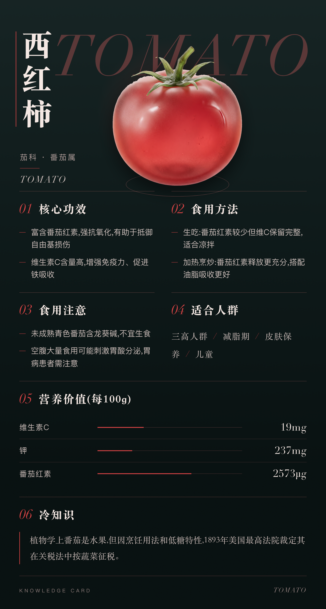

# kcard

[中文](README.md) | [English](README.en.md)

Structured JSON → HTML rendering → Playwright screenshots for shareable knowledge cards. Text comes from structured data, while AI can help draft content or create text-free hero images. Deterministic rendering does not guarantee factual or typographical correctness.

Design systems and production content are separate: `design/styles/` defines styles, layouts, presets, and data contracts; `production/` selects styles and stores card content. See [PLAN.md](PLAN.md) and the generated [style gallery](design/GALLERY.md).



## Setup

Designed for macOS with Python 3.13. There is no locked dependency manifest yet; basic script dependencies are:

```bash
python3.13 -m venv .venv
source .venv/bin/activate
pip install playwright Pillow numpy scipy
python -m playwright install chromium
```

Styles use macOS fonts such as Songti SC, Didot, and PingFang SC. Other operating systems can substitute fonts and alter layout; cross-platform pixel consistency is not promised.

## Use

```bash
python scripts/cutout.py production/food-encyclopedia/cards/tomato/hero.png
python scripts/render.py production/food-encyclopedia/cards/tomato
python scripts/batch.py production/food-encyclopedia
python scripts/style-check.py production/food-encyclopedia
python scripts/regress.py
python scripts/gallery.py
```

`cutout.py` creates transparent hero assets; `render.py` creates `output.png` or paginated `output-01.png`, etc. `batch.py` renders a group. `style-check.py` checks parameter limits and invariants; `regress.py` checks pixel regressions for styles in use. `gallery.py` regenerates the gallery.

## Data flow

`production/<group>/profile.json` selects a style/preset and permitted overrides. Each card contains `card.json` with a `data` object and optional hero images. The style resolves its `STYLE.md`, `space.json`, `engine.html`, layout CSS, preset JSON, and `schema.md`. Current examples cover food, chemical elements, and English vocabulary. Aurora Glass uses 3:4 pagination; other style contracts differ.

Keep HTML/CSS in the design system and content in production groups. Check the selected style's schema before authoring new JSON. Verify content, image provenance, and fonts yourself. This documentation update did not re-render cards.

## License
The default branch does not include a project-level license file. Public visibility does not itself grant reuse rights. Third-party dependencies and assets retain their own terms.
